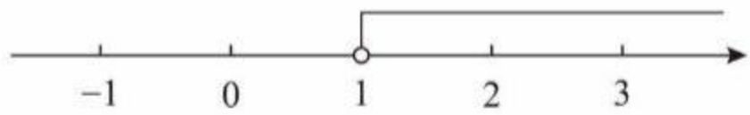

如图，数轴上表示的不等式的解集是

A. x>1

B. x<1

C. $x\geqslant1$

D. $x\leqslant1$

> [!question]- 点击查看答案与解析
> 【答案】A
> 
> 【考点】在数轴上表示不等式的解集 → [[【初中数学知识点体系-人教版】#11-1 不等式]]
> 
> 【解析】
> 数轴上表示不等式的解集：空心圆圈表示不包含该点，实心圆圈表示包含该点。图中数轴在$x=1$处为空心圆圈，且向左画线，表示所有小于1的数，即解集为$x<1$。
> 
> 【易错点】注意空心圆圈（不包含）和实心圆圈（包含）的区别
