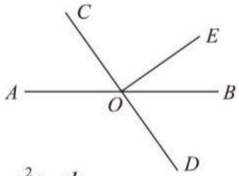

如图，直线AB，CD相交于点O，EO⊥CD，垂足为O. 若∠AOD=125°，则∠BOE的大小为

A. 35°

B. 45°

C. 55°

D. 65°

> [!question]- 点击查看答案与解析
> 【答案】A
> 
> 【考点】相交线中的角度计算（垂线、对顶角、邻补角） → [[【初中数学知识点体系-人教版】#7-1 相交线]]
> 
> 【解析】
> 由$EO\perp CD$得$\angle EOD=90^{\circ}$。
> $\angle AOD=125^{\circ}$，则$\angle AOC=180^{\circ}-125^{\circ}=55^{\circ}$（邻补角）。
> $\angle BOD=\angle AOC=55^{\circ}$（对顶角相等）。
> $\angle BOE=90^{\circ}-55^{\circ}=35^{\circ}$。
> 
> 【易错点】注意垂线形成的直角与对顶角、邻补角的应用
