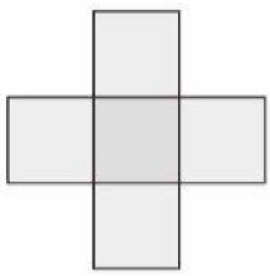
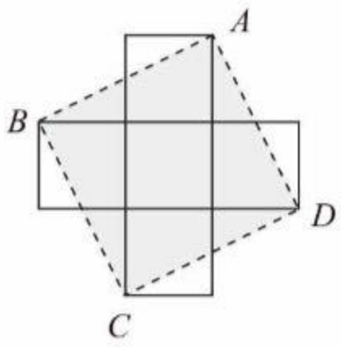

将图1中的5个边长为1的小正方形，剪拼成图2中的大正方形ABCD. 在数轴上，以原点O为圆心，AB为半径作弧，交数轴于点E，则点E表示的数为

图1 

图2 

A. $\sqrt{5}$

B. $\sqrt{5}$ 或 $-\sqrt{5}$

C. 5

D. 5 或 -5

> [!question]- 点击查看答案与解析
> 【答案】B
> 
> 【考点】算术平方根、数轴上的点与实数的对应关系 → [[【初中数学知识点体系-人教版】#8-1 平方根]]
> 
> 【解析】
> 图1中5个小正方形边长为1，总面积为5。
> 图2中大正方形ABCD由这5个小正方形剪拼而成，面积也为5，所以$AB=\sqrt{5}$。
> 在数轴上，以原点O为圆心，$AB=\sqrt{5}$为半径作弧，交数轴于点E，则$OE=\sqrt{5}$。
> 点E表示的数为$\sqrt{5}$或$-\sqrt{5}$。
> 注意题目中"点E"在数轴上的位置，结合图形判断，应选B。
> 
> 【易错点】注意点E可能在数轴正半轴或负半轴
