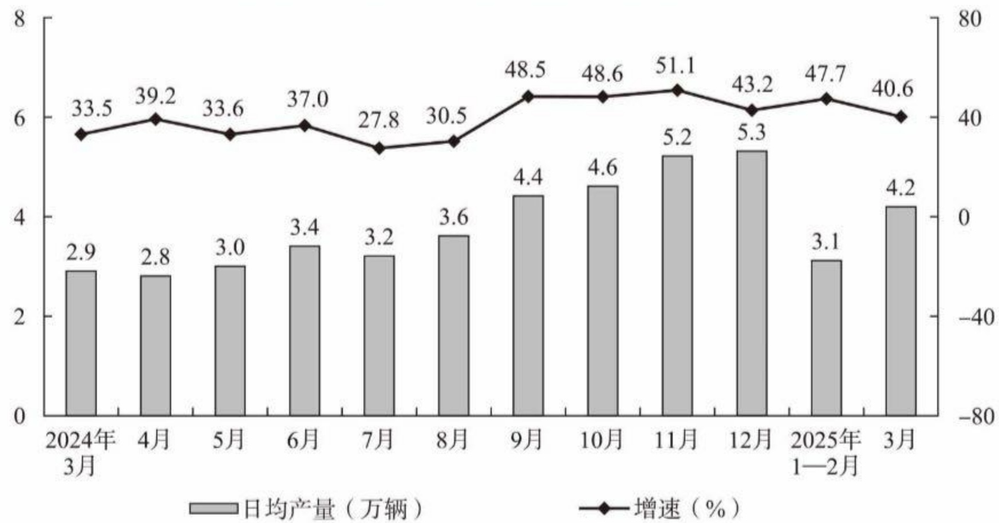

近年来，中国的新能源汽车产业蓬勃发展，为经济发展注入了强劲动力。通过对规模以上工业企业（即年主营业务收入 2000 万及以上的工业企业）工业生产报表按月进行全面调查（1月份数据免报），下图统计了2024年3月—2025年3月期间规模以上工业新能源汽车的相关数据，其中条形图为新能源汽车每月的日均产量，折线图为每月日均产量的同比增速，同比增速=$\left(\frac{\text{本年某月日均产量}}{\text{上年同月日均产量}}\right)\times100\%$。由图判断，下列描述中所有正确的是

$①$ 2024年3月—2025年3月期间，新能源汽车的产量保持同比增长，发展态势良好；

$②$ 2024年的四个季度中，第四季度为新能源汽车的生产旺季；

$③$ 2023年11月的新能源汽车日均产量低于2023年12月的新能源汽车日均产量。

A. $①②$

B. $②③$

C. $①③$

D. $①②③$

规模以上工业新能源汽车同比增速及日均产量 

## 二、填空题（本题共18分，每小题3分）

> [!question]- 点击查看答案与解析
> 【答案】D
> 
> 【考点】条形统计图与折线统计图的综合应用 → [[【初中数学知识点体系-人教版】#12-2 用统计图描述数据]]
> 
> 【解析】
> 分析统计图：
> ①2024年3月—2025年3月期间，折线图（同比增速）始终为正，说明产量保持同比增长，正确；
> ②2024年第四季度（10-12月）条形图（日均产量）明显高于其他季度，正确；
> ③2023年11月的日均产量需根据同比增速推算：2024年11月日均产量÷(1+同比增速)，但由折线图可知2024年11月同比增速为正，说明2023年11月日均产量低于2024年11月，而2024年12月日均产量高于11月，但同比增速为负，说明2023年12月日均产量高于2024年12月。因此2023年11月日均产量低于2023年12月日均产量，正确。
> 因此①②③都正确，选D。
> 
> 【易错点】读懂统计图中的多种数据表示方式
