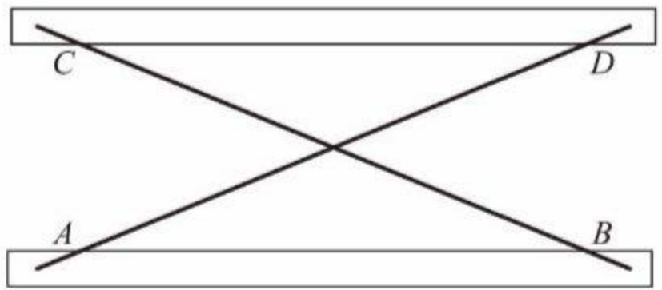

剪叉式升降平台是一种垂直升降、室内外应用广泛的高空作业专用设备. 为确保安全性，避免施工人员站立不稳，它上层的作业平台应与地面保持平行. 图示为剪叉式升降平台简化后的机械结构，只要它的地面仰角（$\angle DAB$）与高空俯角（$\angle CDA$）相等，即可确保上下层平台互相平行. 该方法背后的数学原理是 ___ .

> [!question]- 点击查看答案与解析
> 【答案】内错角相等，两直线平行
> 
> 【考点】平行线的判定（内错角相等） → [[【初中数学知识点体系-人教版】#7-2 平行线]]
> 
> 【解析】
> 地面仰角$\angle DAB$与高空俯角$\angle CDA$相等，即$\angle DAB=\angle CDA$。
> 由图中可知，$\angle DAB$和$\angle CDA$是内错角关系，
> 根据"内错角相等，两直线平行"可知上下层平台互相平行。
> 
> 【易错点】正确识别图形中的内错角关系
