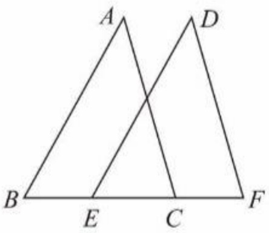

$\triangle DEF$是由 $\triangle ABC$ 平移得到的，点 E 在线段 BC 上. 若 BC=5，AD 的长为无理数，写出一个满足题意的 AD 的长为 ___ .

> [!question]- 点击查看答案与解析
> 【答案】$\sqrt{5}$（答案不唯一）
> 
> 【考点】平移的性质、无理数 → [[【初中数学知识点体系-人教版】#7-4 平移]]
> 
> 【解析】
> $\triangle DEF$是由$\triangle ABC$平移得到的，$E$在线段$BC$上。
> 平移的性质：对应点连线平行且相等，即$AD=BE=CF$，且$AD\parallel BE\parallel CF$。
> $BC=5$，$E$在$BC$上，则$0<BE<5$，即$0<AD<5$。
> 要求$AD$的长为无理数，在$0$到$5$之间的无理数有很多，如$\sqrt{5}$、$\sqrt{2}$、$\pi$等。
> 答案不唯一，$\sqrt{5}$即可。
> 
> 【易错点】注意平移的距离在0到5之间，且要求是无理数
