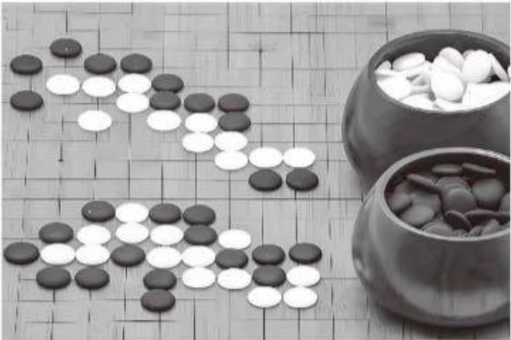
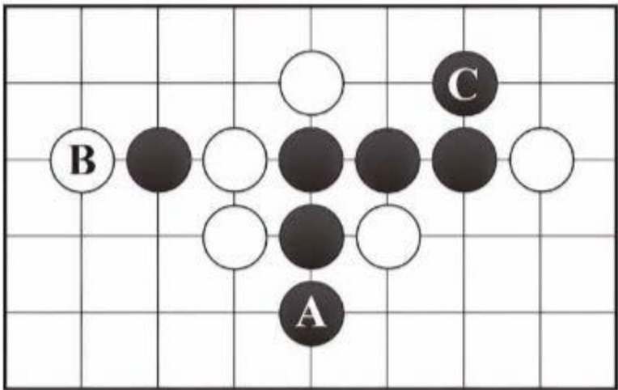

小军和小明进行了一场五子棋比赛. 棋盘如图如示, 若坐标轴均与棋盘中的某条网格线平行, 黑棋 A 所在位置的坐标为 (0, -1), 白棋 B 所在位置的坐标为 (-3, 1), 则黑棋 C 所在位置的坐标为 ___ .

> [!question]- 点击查看答案与解析
> 【答案】$(2,2)$
> 
> 【考点】用坐标表示位置 → [[【初中数学知识点体系-人教版】#9-2 坐标方法的简单应用]]
> 
> 【解析】
> 黑棋A坐标为$(0,-1)$，白棋B坐标为$(-3,1)$。
> 以A为参照，A到B向左平移3个单位，向上平移2个单位，
> 即每个小方格的长度为1个单位。
> 黑棋C的位置：从A$(0,-1)$向右平移2个单位，向上平移3个单位，得$(2,2)$。
> 
> 【易错点】根据已知点坐标确定坐标系的原点和单位长度
