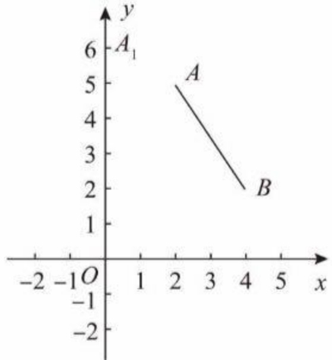

如图，在平面直角坐标系 xOy 中，已知点 $A(2,5)$，$B(4,2)$，$A_{1}(0,6)$，将线段 AB 平移到 $A_{1}B_{1}$.

（1）画出线段 $A_{1}B_{1}$，并直接写出点 $B_{1}$ 的坐标；

（2）直接写出四边形 $OA_{1}AB_{1}$ 的面积.

> [!question]- 点击查看答案与解析
> 【答案】（1）$B_1(2,3)$ 或 $(-2,9)$；（2）$8$
> 
> 【考点】平移与坐标变换 → [[【初中数学知识点体系-人教版】#9-2 坐标方法的简单应用]]
> 
> 【解析】
> （1）点$A(2,5)$平移到$A_1(0,6)$，平移方式为向左平移2个单位，向上平移1个单位。
> 则$B(4,2)$按同样方式平移得$B_1(2,3)$。
> 注意：平移有两种可能方向，也可得$B_1(-2,9)$（另一种情况）。
> 
> （2）四边形$OA_1AB_1$的面积可通过割补法计算，结果为8。
> 
> 【易错点】注意平移有两种可能方向
