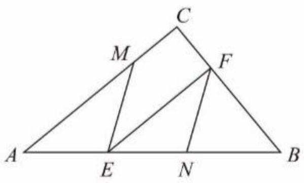

如图，在$\triangle ABC$中，$\angle C=90^\circ$，$AC\parallel EF$，$\angle AME=\angle EFN$.

（1）判断 ME，FN 的位置关系，并说明理由；

（2）若 EF 平分 $\angle MEB$，$\angle FNB = 74^{\circ}$，求 $\angle NFB$ 的度数.

> [!question]- 点击查看答案与解析
> 【答案】（1）$ME\parallel FN$；（2）$\angle NFB=53^{\circ}$
> 
> 【考点】平行线的判定与性质 → [[【初中数学知识点体系-人教版】#7-2 平行线]]
> 
> 【解析】
> （1）$AC\parallel EF$，$\angle AME=\angle EFN$。
> $\because AC\parallel EF$，$\therefore\angle AME=\angle MEF$（两直线平行，内错角相等）。
> $\because\angle AME=\angle EFN$，$\therefore\angle MEF=\angle EFN$。
> $\therefore ME\parallel FN$（内错角相等，两直线平行）。
> 
> （2）由（1）知$ME\parallel FN$，$\therefore\angle MEF=\angle EFN$，$\angle MEB=\angle FNB=74^{\circ}$。
> $\because EF$平分$\angle MEB$，$\therefore\angle MEF=\frac{1}{2}\angle MEB=37^{\circ}$。
> $\because AC\parallel EF$，$\angle C=90^{\circ}$，$\therefore\angle EFB=\angle C=90^{\circ}$（两直线平行，同位角相等）。
> $\therefore\angle NFB=90^{\circ}-\angle EFN=90^{\circ}-37^{\circ}=53^{\circ}$。
> 
> 【易错点】平行线的判定与性质的综合运用，注意区分
