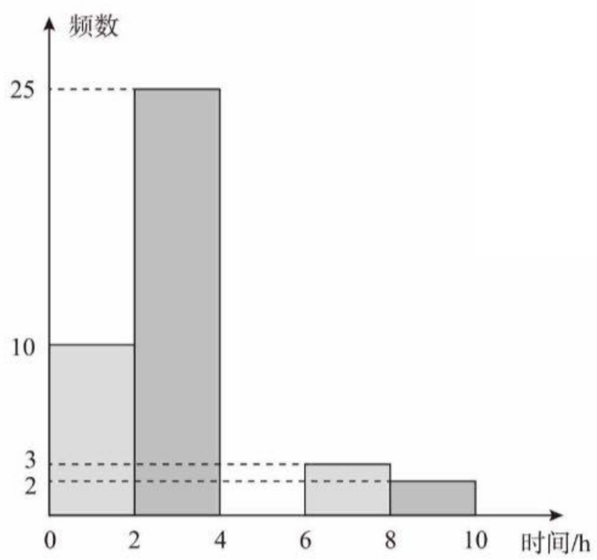
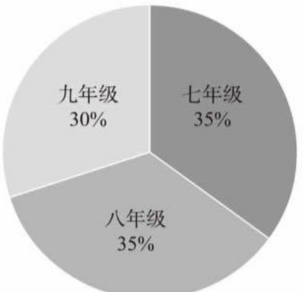

某校七至九年级开展"每周课外阅读情况"调查，对学生某一周课外阅读时间（单位：小时）的数据进行整理、描述和分析，下面给出了部分信息.

a. 七年级一班 50 名学生该周课外阅读时间如下：

| 阅读时间（小时） |$0 \leq x < 2$|$2 \leq x < 4$|$4 \leq x < 6$|$6 \leq x < 8$|
|---|---|---|---|---|
| 学生人数 | 10 | 15 | 18 | 7 |

b. 七年级二班 50 名学生该周课外阅读时间的频数分布直方图如下（数据分 5 组：第 1 组$0 \leq x < 2$，第 2 组 $2 \leq x < 4$，第 3 组 $4 \leq x < 6$，第 4 组 $6 \leq x < 8$，第 5 组 $8 \leq x < 10$）：

c. 七至九年级学生人数扇形统计图：

d. 七至九年级学生共2000人.

根据以上信息，回答下列问题：

（1）$①$ 补全上面的频数分布直方图；

$②$ 该校七年级学生共 ___ 人；

（2）每班将该周课外阅读时间按从高到低的顺序排在前 50%（含）的学生授予"班级阅读之星"称号，若七年级小明同学该周课外阅读时间在七年级一班不能被授予"班级阅读之星"称号，但在七年级二班可以被授予"班级阅读之星"称号，则他的阅读时间 x 满足 ___ ；（填符合要求的序号）

A. $0 \leq x < 2$

B. $2 \leq x < 4$

C. $4 \leq x < 6$

D. $8 \leq x < 10$

（3）小亮同学分析数据时发现，七年级一班、二班该周课外阅读时间小于2小时的人数均占班级人数的20%，因此他估计全校该周课外阅读时间小于2小时的人数约为400人，你同意小亮同学的说法吗？说明理由。

> [!question]- 点击查看答案与解析
> 【答案】（1）①略；②700人；（2）B；（3）不同意，样本不具有代表性
> 
> 【考点】频数分布直方图、扇形统计图、样本估计总体 → [[【初中数学知识点体系-人教版】#12-2 用统计图描述数据]]
> 
> 【解析】
> （1）①频数分布直方图：根据数据补全即可。
> ②七年级学生人数：$2000\times35\%=700$人（扇形统计图占比$35\%$）。
> 
> （2）在七年级一班不能被授予"班级阅读之星"称号，说明他的阅读时间排在后$50\%$；在七年级二班可以被授予，说明他的阅读时间排在前$50\%$。结合数据，阅读时间在$2\leq x<4$小时满足条件，选B。
> 
> （3）不同意。因为样本只取了七年级两个班，不能代表全校七至九年级的总体情况，样本不具有代表性。
> 
> 【易错点】样本的代表性：不能以偏概全
