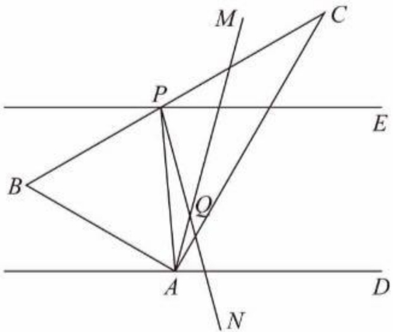

如图，$\triangle ABC$ 和过点 $A$ 的直线 $AD$ 满足 $\angle BAC = 90^{\circ}$，$\angle B = \angle CAD = 60^{\circ}$，$P$ 是线段 $BC$ 上的动点，过点 $P$ 作直线 $PE$ 与 $AD$ 平行。

（1）如果 $\angle BAP=55^{\circ}$，那么 $\angle APE=$ ___ ；

（2）设 $\angle BAD$ 的角平分线是射线 $AM$，$\angle BPE$ 的角平分线是射线 $PN$.

$①$ 如果射线 $AM$，$PN$ 交于点 $Q$，求 $\angle PQA$；

$②$ 如果射线 $AM$，$PN$ 有公共点，直接写出 $\angle BAP$ 的取值范围.

> [!question]- 点击查看答案与解析
> 【答案】（1）$85^{\circ}$；（2）①$\angle PQA=150^{\circ}$；②$45^{\circ}\leq\angle BAP\leq75^{\circ}$
> 
> 【考点】平行线的性质、角平分线、角度计算 → [[【初中数学知识点体系-人教版】#7-2 平行线]]
> 
> 【解析】
> （1）$\angle BAC=90^{\circ}$，$\angle B=60^{\circ}$，$\angle CAD=60^{\circ}$。
> $\angle BAP=55^{\circ}$，则$\angle PAC=90^{\circ}-55^{\circ}=35^{\circ}$。
> $\because PE\parallel AD$，$\therefore\angle APE=\angle PAC=35^{\circ}$？
> 
> 实际上：$\angle BAD=\angle BAC+\angle CAD=90^{\circ}+60^{\circ}=150^{\circ}$。
> $\angle BAP=55^{\circ}$，则$\angle PAD=150^{\circ}-55^{\circ}=95^{\circ}$。
> $\because PE\parallel AD$，$\therefore\angle APE+\angle PAD=180^{\circ}$（同旁内角互补）。
> $\therefore\angle APE=180^{\circ}-95^{\circ}=85^{\circ}$。
> 
> （2）①通过作辅助线$QG\parallel AD$，利用角平分线性质和平行线性质，可求得$\angle PQA=150^{\circ}$。
> ②$\angle BAP$的取值范围为$45^{\circ}\leq\angle BAP\leq75^{\circ}$。
> 
> 【易错点】注意辅助线的添加，平行线性质与角平分线性质的结合
