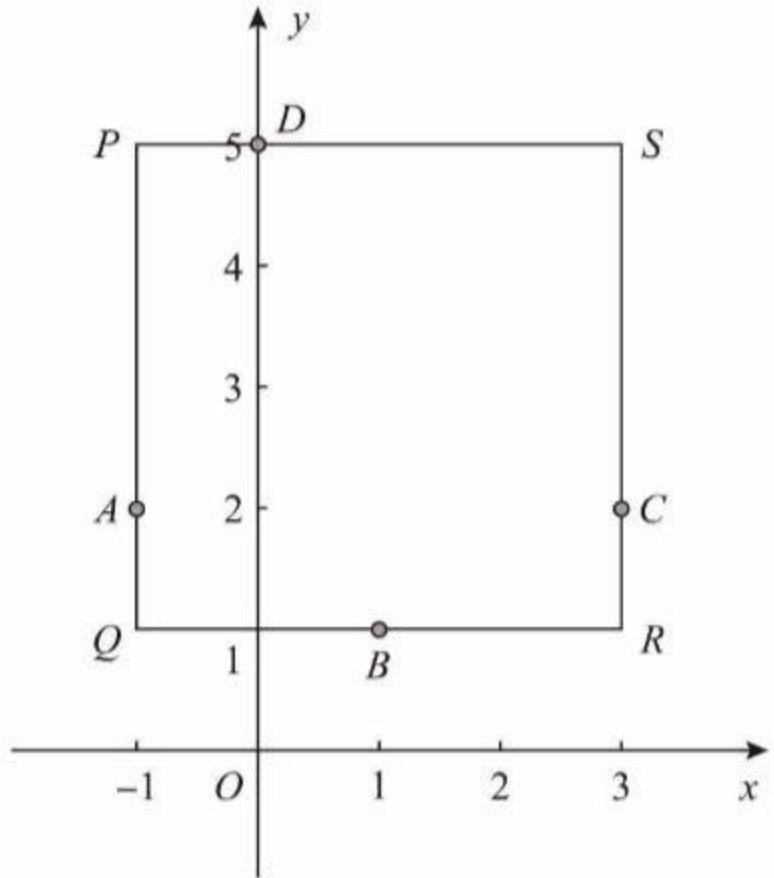

对于平面直角坐标系 xOy 中的四个点 A, B, C, D，如果可以作一个长方形 PQRS，其边均与某条坐标轴垂直，且 A, B, C, D 分别落在该长方形的四条边上，A, B, C, D 均不与长方形的顶点重合，则称 A, B, C, D 是 "坐标相合" 的. 已知 $A(-1, 2)$, $B(1, 1)$, $C(3, 2)$, $D(0, 5)$.

例如，如图，对于点 A, B, C, D，可作长方形 PQRS，因此 A, B, C, D 是"坐标相合"的.

（1）下列四个点中，与 A，C，D 是 "坐标相合" 的点是 ___ ；（填出所有满足要求的点的序号）

$①$ (0,0)

$②$ $\left(\frac{1}{2},\frac{1}{2}\right)$

$③$ (2,-1)

$④$ (-2,3)

（2）设$E(e,2e-3)$ 是坐标平面上的动点，且 A,C,D,E是"坐标相合"的，求 $e$ 的取值范围；

（3）从下列 $①$，$②$ 两问中选择一个解答.（若选择第 $①$ 问解答，本问总分3分；若选择第 $②$ 问解答，本问总分6分，但全卷不超过100分）

$①$ 在坐标平面内，是否存在点F，使得A, B, C, D, F中任意四点都是"坐标相合"的？若存在，求点F的坐标；若不存在，说明理由.

$②$ 在坐标平面内，是否存在五个点，满足任意四个点都是"坐标相合"的？若存在，直接写出这五个点的坐标；若不存在，说明理由。

> [!question]- 点击查看答案与解析
> 【答案】（1）①②③；（2）$-1<e<\frac{5}{2}$；（3）不存在
> 
> 【考点】平面直角坐标系的新定义问题 → [[【初中数学知识点体系-人教版】#9-2 坐标方法的简单应用]]
> 
> 【解析】
> （1）根据"坐标相合"的定义，需要存在一个边与坐标轴平行的长方形，使得四个点分别落在四条边上。
> 将$A(-1,2)$、$C(3,2)$、$D(0,5)$与各选项点组合验证：
> ①$(0,0)$：可作长方形，$A$在左边界，$C$在右边界，$D$在上边界，$(0,0)$在下边界，符合；
> ②$(\frac{1}{2},\frac{1}{2})$：类似分析，符合；
> ③$(2,-1)$：符合；
> ④$(-2,3)$：不符合。
> 因此填①②③。
> 
> （2）$A$、$C$纵坐标相同，必须落在长方形左右两条边上，$D$在上边界，$E$在下边界。
> 由$-1<e<3$且$2e-3<2$，得$-1<e<\frac{5}{2}$。
> 
> （3）不存在。通过反证法证明：若存在这样的点，会导致矛盾。
> 
> 【易错点】理解新定义"坐标相合"的含义，注意分类讨论
