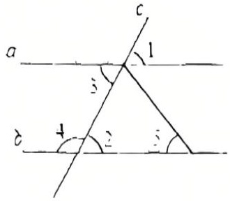

如图，在下列条件中，不能判定直线 a 与 b 平行的是（ ）

第1题

A. $\angle 1 = \angle 2$

B. $\angle 2 = \angle 3$

C. $\angle 1 = \angle 5$

D. $\angle 3 + \angle 4 = 180^{\circ}$

> [!question]- 点击查看答案与解析
> 【答案】C
> 
> 【考点】平行线的判定 → [[【初中数学知识点体系-人教版】#7-2 平行线]]
> 
> 【解析】
> - 选项A：$\angle 1=\angle 2$，是同位角相等，能判定 $a\parallel b$，正确；
> - 选项B：$\angle 2=\angle 3$，是内错角相等，能判定 $a\parallel b$，正确；
> - 选项C：$\angle 1=\angle 5$，$\angle 1$ 与 $\angle 5$ 不是同位角、内错角或同旁内角关系，不能判定平行，错误；
> - 选项D：$\angle 3+\angle 4=180^{\circ}$，是同旁内角互补，能判定 $a\parallel b$，正确。
> 
> 故选C。
> 
> 【易错点】准确识别角的位置关系（同位角、内错角、同旁内角）。
