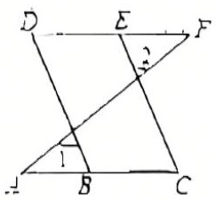

如图，下列条件能得到 $BD // CE$ 的是（ ）

第 2 题

A. $\angle 1 = \angle 2$

B. $\angle A = \angle F$

C. $\angle ABD = \angle 2$

D. $\angle C = \angle D$

> [!question]- 点击查看答案与解析
> 【答案】C
> 
> 【考点】平行线的判定 → [[【初中数学知识点体系-人教版】#7-2 平行线]]
> 
> 【解析】
> - 选项A：$\angle 1=\angle 2$，不能判定 $BD\parallel CE$；
> - 选项B：$\angle A=\angle F$，与 $BD\parallel CE$ 无关；
> - 选项C：$\angle ABD=\angle 2$，是同位角相等，能判定 $BD\parallel CE$，正确；
> - 选项D：$\angle C=\angle D$，不能判定 $BD\parallel CE$。
> 
> 故选C。
> 
> 【易错点】找准被截直线和截线，正确识别同位角、内错角、同旁内角。
