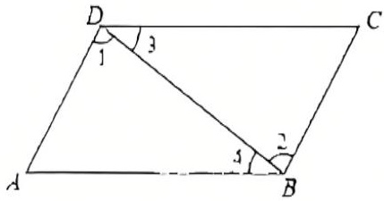

如图，在四边形 $ABCD$中，连接 $BD$，下列判断正确的是（ ）

第 3 题

A. 若 $\angle 1 = \angle 2$，则 $AB // CD$

B. 若 $\angle 3 = \angle 4$，则 $AD // BC$

C. 若 $\angle A + \angle ABC = 180^\circ$，则 $AB // CD$

D. 若 $\angle C + \angle ABC = 180^\circ$，则 $AB // CD$

> [!question]- 点击查看答案与解析
> 【答案】D
> 
> 【考点】平行线的判定 → [[【初中数学知识点体系-人教版】#7-2 平行线]]
> 
> 【解析】
> - 选项A：若 $\angle 1=\angle 2$，则 $AD\parallel BC$（内错角相等），不是 $AB\parallel CD$，错误；
> - 选项B：若 $\angle 3=\angle 4$，则 $AB\parallel CD$（内错角相等），不是 $AD\parallel BC$，错误；
> - 选项C：若 $\angle A+\angle ABC=180^{\circ}$，则 $AD\parallel BC$（同旁内角互补），不是 $AB\parallel CD$，错误；
> - 选项D：若 $\angle C+\angle ABC=180^{\circ}$，则 $AB\parallel CD$（同旁内角互补），正确。
> 
> 故选D。
> 
> 【易错点】根据角的位置关系判断哪两条直线被哪条直线所截。
