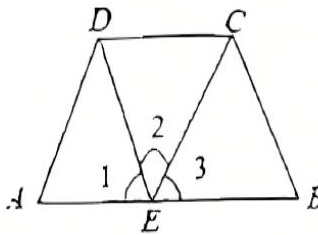

如图所示，下列推理不正确的是（ ）

第 4 题

A. 若 $\angle 1 = \angle B$，则 $BC // DE$

B. 若 $\angle 2 = \angle ADE$，则 $AD // CE$

C. 若 $\angle A + \angle ADC = 180^{\circ}$，则 $AB // CD$

D. 若 $\angle B + \angle BCD = 180^{\circ}$，则 $BC // DE$

> [!question]- 点击查看答案与解析
> 【答案】D
> 
> 【考点】平行线的判定 → [[【初中数学知识点体系-人教版】#7-2 平行线]]
> 
> 【解析】
> - 选项A：$\angle 1=\angle B$，是同位角相等，能判定 $BC\parallel DE$，正确；
> - 选项B：$\angle 2=\angle ADE$，是内错角相等，能判定 $AD\parallel CE$，正确；
> - 选项C：$\angle A+\angle ADC=180^{\circ}$，是同旁内角互补，能判定 $AB\parallel CD$，正确；
> - 选项D：$\angle B+\angle BCD=180^{\circ}$，是同旁内角互补，能判定 $AB\parallel CD$，不是 $BC\parallel DE$，错误。
> 
> 故选D。
> 
> 【易错点】根据同旁内角互补判定的是哪两条直线平行。
