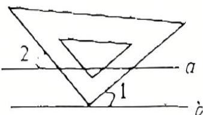

如图把三角板的直角顶点放在直线 $b$ 上，若 $\angle 1 = 40^\circ$，则当 $\angle 2 =$ $\_\_\_\_\_$ 度时，$a // b$.

第 5 题

> [!question]- 点击查看答案与解析
> 【答案】$50$
> 
> 【考点】平行线的判定 → [[【初中数学知识点体系-人教版】#7-2 平行线]]
> 
> 【解析】
> 三角板的直角顶点在直线 $b$ 上，$\angle 1=40^{\circ}$。
> 因为三角板是直角三角板，所以 $\angle 1+\angle 2+90^{\circ}=180^{\circ}$（平角）。
> $\angle 2=180^{\circ}-90^{\circ}-40^{\circ}=50^{\circ}$。
> 当 $\angle 2=50^{\circ}$ 时，$\angle 1$ 与 $\angle 2$ 的对顶角是同位角关系，且 $\angle 1=40^{\circ}$，$\angle 2=50^{\circ}$，此时同位角相等，所以 $a\parallel b$。
> 
> 或者：$\angle 1=40^{\circ}$，要使 $a\parallel b$，需要 $\angle 2$ 与 $\angle 1$ 的余角相等（内错角）。
> $\angle 2=90^{\circ}-40^{\circ}=50^{\circ}$。
> 
> 【易错点】利用三角板的直角性质和平行线的判定条件。
