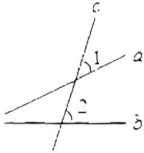

如图，直线 $c$ 与 $a, b$ 相交，$\angle 1 = 40^\circ$，$\angle 2 = 70^\circ$，要使直线 $a$ 与 $b$ 平行，直线 $a$ 顺时针旋转的度数至少是 $\_\_\_\_\_$。

第 6 题

> [!question]- 点击查看答案与解析
> 【答案】$30$
> 
> 【考点】平行线的判定、旋转 → [[【初中数学知识点体系-人教版】#7-2 平行线]]
> 
> 【解析】
> $\angle 1=40^{\circ}$，$\angle 2=70^{\circ}$。
> 要使 $a\parallel b$，需要 $\angle 1$ 的同位角等于 $\angle 2$。
> 当前 $\angle 1=40^{\circ}$，需要旋转到与 $\angle 2=70^{\circ}$ 相等。
> 旋转度数 $=70^{\circ}-40^{\circ}=30^{\circ}$。
> 所以直线 $a$ 顺时针旋转的度数至少是 $30^{\circ}$。
> 
> 【易错点】理解旋转后角的变化与平行线判定的关系。
