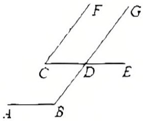

如图，要使 $CF // BG$，你认为应该添加的一个条件是 $\_\_\_\_\_$。

第 7 题

> [!question]- 点击查看答案与解析
> 【答案】$\angle C=\angle G$（答案不唯一）
> 
> 【考点】平行线的判定 → [[【初中数学知识点体系-人教版】#7-2 平行线]]
> 
> 【解析】
> 要使 $CF\parallel BG$，可以添加的条件有多种：
> - 同位角相等：$\angle C=\angle G$
> - 内错角相等：$\angle CFB=\angle GBF$
> - 同旁内角互补：$\angle C+\angle CBG=180^{\circ}$
> 
> 最常用的答案是 $\angle C=\angle G$（同位角相等，两直线平行）。
> 
> 【易错点】答案不唯一，写出一个合理条件即可。
