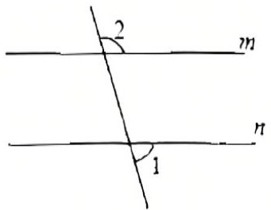

如图，已知 $\angle 1 = (3x + 24)^{\circ}$，$\angle 2 = (5x + 20)^{\circ}$，要使 $m // n$，那么 $\angle 1 =$ $\_\_\_\_\_$（度）.

第 8 题

> [!question]- 点击查看答案与解析
> 【答案】$75$
> 
> 【考点】平行线的判定 → [[【初中数学知识点体系-人教版】#7-2 平行线]]、一元一次方程 → [[【初中数学知识点体系-人教版】#5-1 方程]]
> 
> 【解析】
> 根据图形，$\angle 1$ 与 $\angle 2$ 是同旁内角关系。
> 要使 $m\parallel n$，需要 $\angle 1+\angle 2=180^{\circ}$（同旁内角互补，两直线平行）。
> $(3x+24)+(5x+20)=180$
> $8x+44=180$
> $8x=136$
> $x=17$
> $\angle 1=(3\times 17+24)^{\circ}=75^{\circ}$。
> 验证：$\angle 2=(5\times 17+20)^{\circ}=105^{\circ}$，$75^{\circ}+105^{\circ}=180^{\circ}$，正确。
> 
> 【易错点】根据图形判断角的位置关系，列方程求解。
