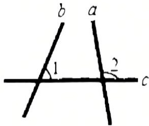

如图，a, b, c 三根木棒钉在一起，$\angle 1 = 70^\circ$，$\angle 2 = 100^\circ$，现将木棒 a、b 同时顺时针旋转一周，速度分别为 17 度/秒和 2 度/秒，则 $\_\_\_\_\_$ 秒后木棒 a, b 平行.

第 9 题

> [!question]- 点击查看答案与解析
> 【答案】$2$ 或 $14$
> 
> 【考点】平行线的判定 → [[【初中数学知识点体系-人教版】#7-2 平行线]]、一元一次方程 → [[【初中数学知识点体系-人教版】#5-1 方程]]、分类讨论
> 
> 【解析】
> 初始状态：$\angle 1=70^{\circ}$，$\angle 2=100^{\circ}$。
> 木棒 $a$、$b$ 同时顺时针旋转，速度分别为 $17$ 度/秒和 $2$ 度/秒。
> 设 $t$ 秒后木棒 $a$、$b$ 平行。
> 
> 相对旋转速度为 $17-2=15$ 度/秒。
> 初始角度差为 $100-70=30^{\circ}$。
> 
> 要使 $a\parallel b$，角度差需要变为 $0^{\circ}$ 或 $180^{\circ}$（模 $360^{\circ}$）。
> 
> 情况一：角度差变为 $0^{\circ}$
> $15t=30$
> $t=2$（秒）
> 
> 情况二：角度差变为 $180^{\circ}$
> $15t=30+180$
> $15t=210$
> $t=14$（秒）
> 
> 验证：$t=2$ 时，木棒 $a$ 旋转 $34^{\circ}$，木棒 $b$ 旋转 $4^{\circ}$，角度差为 $0^{\circ}$，平行。
> $t=14$ 时，木棒 $a$ 旋转 $238^{\circ}$，木棒 $b$ 旋转 $28^{\circ}$，角度差为 $180^{\circ}$，平行。
> 
> 综上，$2$ 秒或 $14$ 秒后木棒 $a$、$b$ 平行。
> 
> 【易错点】理解相对运动，利用角度差建立方程。
