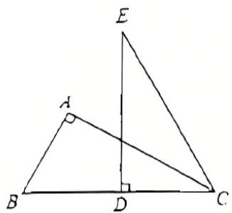

两块含 $30^{\circ}$ 角的三角尺叠放如图所示，现固定三角尺 ABC 不动，将三角尺 DEC 绕顶点 C 顺时针转动，使两块三角尺至少有一个组边互相平行，且点 D 在直线 BC 的上方，则 $\angle BCD$ 所有可能符合的度数为 $\_\_\_\_\_$。

第 10 题

> [!question]- 点击查看答案与解析
> 【答案】$30^{\circ}$、$60^{\circ}$、$90^{\circ}$、$120^{\circ}$、$150^{\circ}$
> 
> 【考点】平行线的判定、分类讨论 → [[【初中数学知识点体系-人教版】#7-2 平行线]]
> 
> 【解析】
> 两块含 $30^{\circ}$ 角的三角尺，三角尺 ABC 固定，三角尺 DEC 绕点 C 顺时针转动。
> 三角尺的三个角分别是 $30^{\circ}$、$60^{\circ}$、$90^{\circ}$。
> 
> 要使两块三角尺至少有一组边互相平行，需要考虑所有可能的平行情况：
> 
> 情况一：$DE\parallel AB$
> 此时 $\angle BCD=30^{\circ}$。
> 
> 情况二：$DE\parallel BC$
> 此时 $\angle BCD=60^{\circ}$。
> 
> 情况三：$DC\parallel AB$
> 此时 $\angle BCD=90^{\circ}$。
> 
> 情况四：$EC\parallel AB$
> 此时 $\angle BCD=120^{\circ}$。
> 
> 情况五：$DE\parallel AC$
> 此时 $\angle BCD=150^{\circ}$。
> 
> 综上，$\angle BCD$ 所有可能的度数为 $30^{\circ}$、$60^{\circ}$、$90^{\circ}$、$120^{\circ}$、$150^{\circ}$。
> 
> 【易错点】全面考虑所有可能的平行组合，不遗漏情况。
