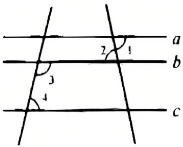

如图，$\angle 1 = \angle 2$，$\angle 3 + \angle 4 = 180^\circ$。试确定直线 a 与直线 c 的位置关系，并说明你的理由。

第 11 题

(1) 问题的结论：$a \_\_\_\_\_ c$.

(2) 思路分析：欲说明 $a \_\_\_\_\_ c$.

只要说明 $\_\_\_\_\_ // \_\_\_\_\_$ 且 $\_\_\_\_\_ // \_\_\_\_\_$ 即可.

(3) 理由如下:

$\because \angle 1 = \angle 2$ ($\_\_\_\_\_$)

$\therefore a // \_\_\_\_\_\_$ ($\_\_\_\_\_$)  ①

$\because \angle 3 + \angle 4 = 180^\circ$ ($\_\_\_\_\_$)

$\therefore c //\_\_\_\_\_\_$ ($\_\_\_\_\_$)  ②

由①②得，$a // \_\_\_$，$c // \_\_\_$

$\therefore a \underline{\qquad} c.$ ($\_\_\_\_\_$)

> [!question]- 点击查看答案与解析
> 【答案】(1) $a\parallel c$；(2) $a\parallel c$；$a$；$b$；$b$；$c$；(3) 已知；$b$；同位角相等，两直线平行；已知；$b$；同旁内角互补，两直线平行；$b$；$b$；$\parallel$；平行于同一条直线的两条直线平行
> 
> 【考点】平行线的判定与平行公理推论 → [[【初中数学知识点体系-人教版】#7-2 平行线]]
> 
> 【解析】
> 
> (1) 问题的结论：$a\parallel c$。
> 
> (2) 思路分析：欲说明 $a\parallel c$。
> 只要说明 $a\parallel b$ 且 $c\parallel b$ 即可。
> 
> (3) 理由如下：
> $\because \angle 1=\angle 2$（已知）
> $\therefore a\parallel b$（同位角相等，两直线平行）  ①
> 
> $\because \angle 3+\angle 4=180^{\circ}$（已知）
> $\therefore c\parallel b$（同旁内角互补，两直线平行）  ②
> 
> 由①②得，$a\parallel b$，$c\parallel b$。
> $\therefore a\parallel c$（平行于同一条直线的两条直线平行）。
> 
> 【易错点】利用"平行于同一条直线的两条直线平行"这一推论。
