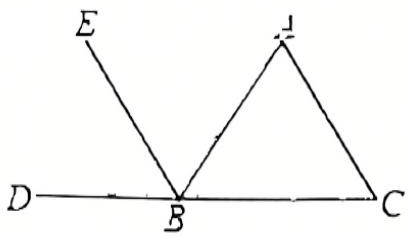

如图，点 B 在 DC 上，BE 平分 $\angle ABD$，$\angle ABE = \angle C$，求证：$BE // AC$。

第 12 题

> [!question]- 点击查看答案与解析
> 【答案】见解析
> 
> 【考点】平行线的判定、角平分线 → [[【初中数学知识点体系-人教版】#7-2 平行线]]
> 
> 【解析】
> 证明：
> $\because BE$ 平分 $\angle ABD$（已知）
> $\therefore \angle ABE=\angle EBD$（角平分线的定义）
> 
> 又 $\because \angle ABE=\angle C$（已知）
> $\therefore \angle EBD=\angle C$（等量代换）
> 
> $\therefore BE\parallel AC$（同位角相等，两直线平行）
> 
> 【易错点】利用角平分线的定义进行等量代换，找到同位角相等。
