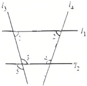

如图，若直线 $l_{1} // l_{2}$，则下列各式成立的是（ ）

第 1 题

A. $\angle1 = \angle2$

B. $\angle4 = \angle5$

C. $\angle2 + \angle5 = 180^{\circ}$

D. $\angle1 + \angle3 = 180^{\circ}$

> [!question]- 点击查看答案与解析
> 【答案】D
> 
> 【考点】平行线的性质 → [[【初中数学知识点体系-人教版】#7-2 平行线]]
> 
> 【解析】
> - 选项A：$\angle 1$ 与 $\angle 2$ 不是同位角或内错角关系，不能确定相等，错误；
> - 选项B：$\angle 4$ 与 $\angle 5$ 不是同位角或内错角关系，不能确定相等，错误；
> - 选项C：$\angle 2$ 与 $\angle 5$ 是同位角，应相等而非互补，错误；
> - 选项D：$\angle 1$ 与 $\angle 3$ 是同旁内角，两直线平行，同旁内角互补，即 $\angle 1+\angle 3=180^{\circ}$，正确。
> 
> 【易错点】根据角的位置关系判断是同位角、内错角还是同旁内角。
