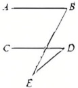

如图，直线 $AB // CD$，$\angle B = 50^{\circ}$，$\angle D = 20^{\circ}$，则 $\angle E$ 的度数是（ ）

第 3 题

A. $20^{\circ}$

B. $30^{\circ}$

C. $50^{\circ}$

D. $70^{\circ}$

> [!question]- 点击查看答案与解析
> 【答案】B
> 
> 【考点】平行线的性质、三角形外角 → [[【初中数学知识点体系-人教版】#7-2 平行线]]
> 
> 【解析】
> 因为 $AB\parallel CD$，所以 $\angle B=\angle ECD=50^{\circ}$（两直线平行，同位角相等）。
> 在 $\triangle CDE$ 中，$\angle E=\angle ECD-\angle D=50^{\circ}-20^{\circ}=30^{\circ}$（三角形外角等于不相邻两个内角之和的推论）。
> 
> 【易错点】利用平行线性质将角转化到三角形中，再利用三角形角度关系求解。
