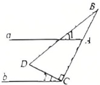

已知，直线 $a // b$，直角三角形如图放置， $\angle DCB = 90^{\circ}$，若 $\angle 1 + \angle B = 64^{\circ}$，则 $\angle 2$ 的度数为（ ）

第 4 题

A. $20^{\circ}$

B. $26^{\circ}$

C. $30^{\circ}$

D. $35^{\circ}$

> [!question]- 点击查看答案与解析
> 【答案】B
> 
> 【考点】平行线的性质、三角形外角 → [[【初中数学知识点体系-人教版】#7-2 平行线]]
> 
> 【解析】
> $\angle 1+\angle B=64^{\circ}$，由三角形外角性质，$\angle 1+\angle B$ 等于 $\triangle BCD$ 中 $\angle CDB$ 的外角。
> 因为 $a\parallel b$，利用平行线性质将角转化。
> $\angle 2$ 与 $\angle 1$ 和 $\angle B$ 存在内错角或同位角关系。
> 
> 设 $\angle 1$ 对应的内错角为 $\angle x$，则 $\angle x=\angle 1$（两直线平行，内错角相等）。
> 在直角三角形中，$\angle 2+\angle x+\angle B=90^{\circ}$（因为 $\angle DCB=90^{\circ}$）。
> $\angle 2=90^{\circ}-(\angle 1+\angle B)=90^{\circ}-64^{\circ}=26^{\circ}$。
> 
> 【易错点】利用平行线性质和直角三角形的角度关系。
