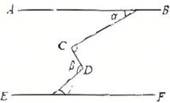

如图，$AB // EF$，$\angle C = 90^\circ$，则 $\alpha$、$\beta$、$\gamma$ 的关系为（ ）

第 5 题

A. $\beta = \alpha + \gamma$

B. $\alpha + \beta - \gamma = 90^\circ$

C. $\alpha + \beta + \gamma = 180^\circ$

D. $\beta + \gamma - \alpha = 90^\circ$

> [!question]- 点击查看答案与解析
> 【答案】B
> 
> 【考点】平行线的性质、折线角关系 → [[【初中数学知识点体系-人教版】#7-2 平行线]]
> 
> 【解析】
> 过点 $C$ 作 $CH\parallel AB$，则 $CH\parallel EF$（平行于同一直线的两直线平行）。
> 由平行线性质：$\angle ACH=\alpha$（内错角），$\angle HCF=\beta-\angle ACH=\beta-\alpha$。
> $\angle E=\gamma$，$\angle HCF$ 与 $\angle E$ 是内错角关系：$\angle HCF=90^{\circ}-\gamma$。
> 所以 $\beta-\alpha=90^{\circ}-\gamma$，即 $\alpha+\beta-\gamma=90^{\circ}$。
> 
> 【易错点】作辅助平行线，利用平行线性质建立角的关系。
