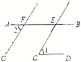

如图，$AB // CD$，$CE // GF$，若 $\angle 1 = 60^\circ$，则 $\angle 2 = \_\_\_\_\_$。

第 6 题

> [!question]- 点击查看答案与解析
> 【答案】$60^{\circ}$
> 
> 【考点】平行线的性质 → [[【初中数学知识点体系-人教版】#7-2 平行线]]
> 
> 【解析】
> 因为 $AB\parallel CD$，所以 $\angle 1=\angle DCE=60^{\circ}$（两直线平行，内错角相等）。
> 因为 $CE\parallel GF$，所以 $\angle DCE=\angle 2=60^{\circ}$（两直线平行，同位角相等）。
> 
> 【易错点】多次运用平行线性质进行角的传递。
