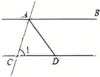

如图，已知 $AB // CD$，$AD$ 平分 $\angle BAC$，$\angle 1 = 70^\circ$，则 $\angle ADC$ 的度数是 $\_\_\_\_\_$。

第 7 题

> [!question]- 点击查看答案与解析
> 【答案】$55^{\circ}$
> 
> 【考点】平行线的性质、角平分线 → [[【初中数学知识点体系-人教版】#7-2 平行线]]
> 
> 【解析】
> 因为 $AB\parallel CD$，所以 $\angle 1+\angle BAC=180^{\circ}$（两直线平行，同旁内角互补）。
> $\angle BAC=180^{\circ}-70^{\circ}=110^{\circ}$。
> 因为 $AD$ 平分 $\angle BAC$，所以 $\angle DAC=\frac{1}{2}\angle BAC=55^{\circ}$。
> 因为 $AB\parallel CD$，所以 $\angle ADC=\angle BAD=55^{\circ}$（两直线平行，内错角相等）。
> 
> 【易错点】综合利用角平分线和平行线的性质。
