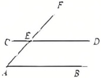

如图，$AB // CD$，$AF$ 交 $CD$ 于点 $E$，若 $\angle CEF = 138^\circ23'$，则 $\angle A = \_\_\_\_\_$。

第 8 题

> [!question]- 点击查看答案与解析
> 【答案】$41^{\circ}37'$
> 
> 【考点】平行线的性质、邻补角 → [[【初中数学知识点体系-人教版】#7-2 平行线]]
> 
> 【解析】
> $\angle CEF=138^{\circ}23'$，所以 $\angle AED=138^{\circ}23'$（对顶角相等）。
> $\angle AEC=180^{\circ}-138^{\circ}23'=41^{\circ}37'$（邻补角）。
> 因为 $AB\parallel CD$，所以 $\angle A=\angle AEC=41^{\circ}37'$（两直线平行，内错角相等）。
> 
> 【易错点】角度的度分秒换算；邻补角的计算。
