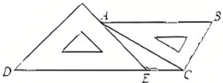

一副三角板按如图所示放置，$AB // DC$，则 $\angle CAE$ 的度数为 $\_\_\_\_\_$.

第9题

> [!question]- 点击查看答案与解析
> 【答案】$15^{\circ}$
> 
> 【考点】平行线的性质、三角尺角度 → [[【初中数学知识点体系-人教版】#7-2 平行线]]
> 
> 【解析】
> 一副三角板：一个是 $45^{\circ}-45^{\circ}-90^{\circ}$，另一个是 $30^{\circ}-60^{\circ}-90^{\circ}$。
> 因为 $AB\parallel DC$，利用平行线性质和三角尺的特殊角度。
> $\angle BAC=45^{\circ}$（$45^{\circ}$ 三角板），$\angle ACD=30^{\circ}$（$30^{\circ}$ 三角板）。
> $\angle CAE=\angle BAC-\angle ACD=45^{\circ}-30^{\circ}=15^{\circ}$（内错角相等的推论）。
> 
> 【易错点】熟悉三角尺的角度，利用平行线性质转化角。
