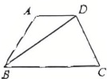

如图，已知 $AD // BC$，$BD$ 平分 $\angle ABC$，$\angle A = 112^\circ$，且 $BD \perp CD$，则 $\angle ADC = \_\_\_\_\_$。

第 10 题

> [!question]- 点击查看答案与解析
> 【答案】$56^{\circ}$
> 
> 【考点】平行线的性质、角平分线、垂直 → [[【初中数学知识点体系-人教版】#7-2 平行线]]
> 
> 【解析】
> 因为 $AD\parallel BC$，所以 $\angle A+\angle ABC=180^{\circ}$（两直线平行，同旁内角互补）。
> $\angle ABC=180^{\circ}-112^{\circ}=68^{\circ}$。
> 因为 $BD$ 平分 $\angle ABC$，所以 $\angle DBC=\frac{1}{2}\angle ABC=34^{\circ}$。
> 因为 $BD\perp CD$，所以 $\angle BDC=90^{\circ}$。
> 在 $\triangle BDC$ 中，$\angle C=180^{\circ}-90^{\circ}-34^{\circ}=56^{\circ}$。
> 因为 $AD\parallel BC$，所以 $\angle ADC=\angle C=56^{\circ}$（两直线平行，内错角相等）。
> 
> 【易错点】综合利用平行线、角平分线和垂直的性质。
