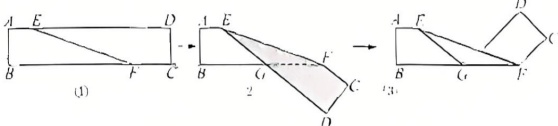

如图 ① 是长方形纸带，$\angle DEF = a$，将纸带沿 EF 折叠成图 ②，再沿 BF 折叠成图 ③，则图 ③ 中的 $\angle CFE$ 的度数是 $\_\_\_\_\_$。

第 11 题

> [!question]- 点击查看答案与解析
> 【答案】$180^{\circ}-3a$
> 
> 【考点】平行线的性质、折叠问题 → [[【初中数学知识点体系-人教版】#7-2 平行线]]
> 
> 【解析】
> 图 $①$：$\angle DEF=a$，因为长方形对边平行，$\angle EFB=a$（内错角相等）。
> 图 $②$：沿 $EF$ 折叠，$\angle EFC=180^{\circ}-a$，折叠后 $\angle EFC'=\angle EFC=180^{\circ}-a$。
> 图 $③$：再沿 $BF$ 折叠，$\angle CFE$ 的度数在每次折叠后发生变化。
> 
> 第一次折叠：$\angle CFE=180^{\circ}-2a$。
> 第二次折叠：$\angle CFE=180^{\circ}-3a$。
> 
> 推导：
> 图 $①$ 中 $\angle EFB=a$。
> 图 $②$ 中 $\angle EFC=180^{\circ}-a-\angle EFB=180^{\circ}-2a$。
> 图 $③$ 中 $\angle CFE=180^{\circ}-3a$。
> 
> 【易错点】折叠问题中角度的变化规律，每次折叠都会产生对称角。
