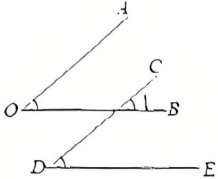

如图，$AO // CD$，$OB // DE$，$\angle O = 40^{\circ}$，求 $\angle D$ 的度数.

(1) 诸完成下列书写过程.

$\because AO // CD$ （已知）

$\therefore \angle O = \_\_\_\_\_\_ = 40^{\circ}$ （$\_\_\_\_\_$）

又 $\because OB // DE$ （已知）

$\therefore \_\_\_ = \angle 1 = \_\_\_ ^{\circ}$ （$\_\_\_\_\_$）

(2) 若在平面内取一点 M，作射线 $MP // OA$，$MQ // OB$，则 $\angle PMQ = \_\_\_ ^{\circ}$.

> [!question]- 点击查看答案与解析
> 【答案】(1) $\angle 1$；两直线平行，同位角相等；$\angle D$；$140$；两直线平行，同旁内角互补；(2) $40^{\circ}$ 或 $140^{\circ}$
> 
> 【考点】平行线的性质、分类讨论 → [[【初中数学知识点体系-人教版】#7-2 平行线]]
> 
> 【解析】
> 
> (1) 
> $\because AO\parallel CD$（已知）
> $\therefore \angle O=\angle 1=40^{\circ}$（两直线平行，同位角相等）
> 又 $\because OB\parallel DE$（已知）
> $\therefore \angle D+\angle 1=180^{\circ}$（两直线平行，同旁内角互补）
> $\therefore \angle D=180^{\circ}-40^{\circ}=140^{\circ}$
> 
> (2) $MP\parallel OA$，$MQ\parallel OB$。
> 当 $M$ 在不同位置时，$\angle PMQ$ 可能等于 $\angle AOB$ 或其补角。
> $\angle PMQ=40^{\circ}$ 或 $140^{\circ}$。
> 
> 【易错点】分类讨论点 $M$ 的位置，利用平行线性质。
