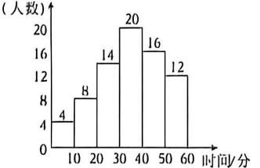

（2024·西城区校级期末）小明同学统计了他所在小区居民每天早晨跑步的时间，并绘制了频数分布直方图。如图所示：$①$ 小明同学·共统计了 74 人；$②$ 每天早晨跑步不足 30 分钟的有 14 人；$③$ 每天早晨跑步 30~40 分钟的人数最多；$④$ 每天早晨跑步 0~10 分钟的人数最少。根据图中信息，上述说法中正确的是（ ）

频数
（人数）

A. $①②③$

B. $②③④$

C. $①③④$

D. $①②③④$

> [!question]- 点击查看答案与解析
> **【答案】** D
> 
> **【考点】** 频数分布直方图的阅读与分析 [[【初中数学知识点体系-人教版】#12-2 用统计图描述数据]]
> 
> **【解析】**
> 
> 根据频数分布直方图逐项判断：
> - $①$ 各小组频数之和等于总人数，统计直方图中各组的频数，若和为74，则说法正确；
> - $②$ 每天早晨跑步不足30分钟包含 $0\sim10$ 分钟、$10\sim20$ 分钟、$20\sim30$ 分钟三组，将这三组的频数相加，若和为14，则说法正确；
> - $③$ 比较直方图中各组的频数（即条形的高度），若 $30\sim40$ 分钟这一组最高，则说法正确；
> - $④$ 比较直方图中各组的频数，若 $0\sim10$ 分钟这一组最矮，则说法正确。
> 
> 根据直方图数据，四个说法均正确，故选D。
> 
> **【易错点】** 漏算某一组的频数导致总人数计算错误；忽略"不足30分钟"包含前三组而非仅第一组。
