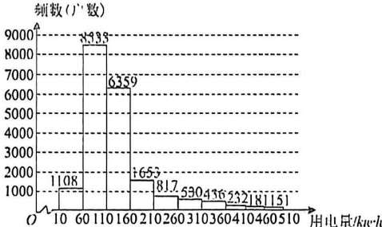

（2023·大兴区期末）为倡导绿色发展，避免浪费能源，某市准备对居民用电量采用阶梯收费的方法，计划实施三档的阶梯电价：第一档、第二档和第三档的电价分别覆盖全市居民家庭的 80%，15% 和 5%。为了合理确定各档之间的界限，相关部门在该市随机调查了 20000 户居民 6 月份的用电量（单位： $kw\cdot h$），并将收集的样本数据进行排序整理（排序样本），绘制了如下频数分布直方图（每段用电量均含最小值，不含最大值）。

根据统计数据，下面有四个推断：

$①$ 抽样调查 6 月份的用电量，是因为 6 月份的用电量在一年12个月的用电量中处于中等偏上水平

$②$ 在调查的 20000 户居民中，6 月份的用电量的最大值与最小值的差小于 500

$③$ 月用电量小于 $160kw\cdot h$ 的该市居民家庭按第一档电价交费，月用电量不小于 $310kw\cdot h$ 的该市居民家庭按第三档电价交费

$④$ 该市居民家庭月用电量的中间水平（50% 的用户）为 $110\,kW\cdot h$

其中合理的是（ ）

A. $①②③$

B. $①②④$

C. $①③④$

D. $②③④$

> [!question]- 点击查看答案与解析
> **【答案】** A
> 
> **【考点】** 频数分布直方图在阶梯电价方案中的应用 [[【初中数学知识点体系-人教版】#12-2 用统计图描述数据]]
> 
> **【解析】**
> 
> 根据频数分布直方图和阶梯电价方案逐项分析：
> - $①$ 6月份处于夏季，居民用电量在一年12个月中处于中等偏上水平，抽样调查6月份用电量具有代表性，合理；
> - $②$ 从直方图看，用电量的最小值在 $0\sim50$ 范围内，最大值在 $450\sim500$ 范围内，最大值与最小值的差小于 $500-0=500$，合理；
> - $③$ 第一档电价覆盖80%的居民家庭，从直方图累积频数看，月用电量小于 $160\,kW\cdot h$ 的户数接近80%，合理；第三档覆盖5%的居民家庭，月用电量不小于 $310\,kW\cdot h$ 的户数接近5%，合理；
> - $④$ 中间水平（50%的用户）对应的月用电量需根据累积频数确定，从直方图看50%分位数并非恰好 $110\,kW\cdot h$，不合理。
> 
> 综上，$①②③$ 合理，$④$ 不合理，故选A。
> 
> **【易错点】** 对"中间水平（50%的用户）"的理解有误，将其理解为平均数而非中位数对应的用电量。
