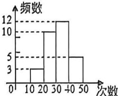

（2024·大兴区校级期末）某校八年级为了解学生的居家锻炼情况，随机抽查了八年级的 30 名学生的一分钟仰卧起坐的次数，将数据分组整理后，绘制了如图所示的频数分布直方图，估计八年级学生仰卧起坐的次数在 30~40 次的频率是 ___。

> [!question]- 点击查看答案与解析
> **【答案】** $\frac{\text{30~40次段频数}}{30}$（需根据直方图中 $30\sim40$ 次段的频数计算）
> 
> **【考点】** 频数与频率的计算 [[【初中数学知识点体系-人教版】#12-1 统计调查]]
> 
> **【解析】**
> 
> 频率是指某一组的频数与样本容量的比值。本题样本容量为30名学生，30~40次的频率 = $\frac{30\sim40\text{次段的频数}}{30}$。
> 
> 具体步骤：从频数分布直方图中读出 $30\sim40$ 次这一组的频数（即该组条形的高度），代入公式计算即可。
> 
> 例如，若 $30\sim40$ 次段的频数为10，则频率为 $\frac{10}{30}=\frac{1}{3}\approx0.333$。
> 
> **【易错点】** 将频率与频数混淆，直接用频数作为答案；或计算时样本容量用错。
