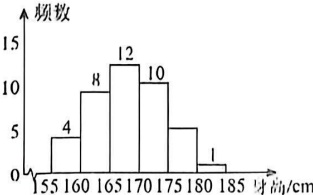

（2023·石景山区期末）根据某班 40 名学生身高的频数分布直方图（每组不含起点值，含终点值），回答下列问题：

（1）人数最多的身高范围是 ___ ；

（2）身高大于 $175\,cm$ 的学生占全班人数的百分比是 ___ .

> [!question]- 点击查看答案与解析
> **【答案】** （1）需根据直方图找出频数最大的组（常见为 $165\sim170\,cm$ 或 $160\sim165\,cm$）；（2）$\frac{\text{身高}>175\,cm\text{的人数}}{40}\times100\%$
> 
> **【考点】** 频数分布直方图的读图与应用 [[【初中数学知识点体系-人教版】#12-2 用统计图描述数据]]
> 
> **【解析】**
> 
> （1）人数最多的身高范围即直方图中频数最大（条形最高）的那一组。从频数分布直方图中找出最高的条形，其对应的身高范围即为答案。
> 
> （2）身高大于 $175\,cm$ 的学生占全班人数的百分比 = $\frac{\text{身高}>175\,cm\text{的学生人数}}{\text{全班总人数（40人）}}\times100\%$。
> 
> 具体步骤：从直方图中找出 $175\sim180\,cm$、$180\sim185\,cm$ 等所有大于 $175\,cm$ 的组，将它们的频数相加，除以总人数40，再乘以 $100\%$ 即可。
> 
> **【易错点】** （1）忽略了"每组不含起点值，含终点值"的规则，导致取错组的范围；（2）计算百分比时遗漏乘以 $100\%$，或分母误用为其他数值。
