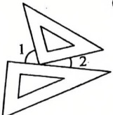

将一副三角板按如图所示的方式摆放，且 $\angle 1$ 比 $\angle 2$ 大 $50^{\circ}$. 若设 $\angle 1=x^{\circ},\angle 2=y^{\circ}$，则可得到的方程组为

A. $\left\{\begin{aligned}x=y-50,\\ x+y=180\end{aligned}\right.$

B. $\left\{\begin{aligned}x=y+50,\\ x+y=180\end{aligned}\right.$

C. $\left\{\begin{aligned}x=y-50,\\ x+y=90\end{aligned}\right.$

D. $\left\{\begin{aligned}x=y+50,\\ x+y=90\end{aligned}\right.$

> [!question]- 点击查看答案与解析
> 【答案】D
> 
> 【考点】列二元一次方程组、三角板角度 → [[【初中数学知识点体系-人教版】#10-3 实际问题与二元一次方程组]]
> 
> 【解析】
> 由题意，$\angle 1$ 比 $\angle 2$ 大 $50^{\circ}$，所以 $x=y+50$。
> 由图形可知，$\angle 1+\angle 2+90^{\circ}=180^{\circ}$（三角板直角），所以 $x+y=90$。
> 
> 方程组为 $\left\{\begin{aligned}x=y+50,\\ x+y=90.\end{aligned}\right.$
> 
> 故选D。
> 
> 【易错点】根据题意和图形正确列出两个方程。
