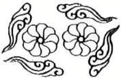
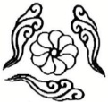
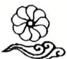

列方程(组)解应用题.

如图所示，某工厂生产镂空的铝板雕花造型，造型由 $\Lambda$（绣球花），$B$（祥云）两种图案组合而成。因制作工艺不同，$A,B$ 两种图案成本不同，厂家提供了如下几种设计造型，其中造型 1 的成本为 64 元，造型 2 的成本为 42 元，则造型 3 的成本为多少元？

造型1 

造型2 

造型3 

> [!question]- 点击查看答案与解析
> 【答案】需根据具体图形确定
> 
> 【考点】列二元一次方程组解应用题 → [[【初中数学知识点体系-人教版】#10-3 实际问题与二元一次方程组]]
> 
> 【解析】
> 设图案 A 的成本为 $x$ 元，图案 B 的成本为 $y$ 元。
> 
> 解题方法：
> 1. 数出造型1中A和B的个数，设分别为 $a_1$ 个A和 $b_1$ 个B，则 $a_1x+b_1y=64$。
> 2. 数出造型2中A和B的个数，设分别为 $a_2$ 个A和 $b_2$ 个B，则 $a_2x+b_2y=42$。
> 3. 解方程组 $\left\{\begin{aligned}a_1x+b_1y&=64,\\ a_2x+b_2y&=42.\end{aligned}\right.$ 求出 $x,y$。
> 4. 数出造型3中A和B的个数，设分别为 $a_3$ 个A和 $b_3$ 个B，则造型3的成本为 $a_3x+b_3y$。
> 
> 由于图片中图案数量不清晰，请根据实际图形按上述方法计算。
> 
> 【易错点】准确数出每个造型中A和B的图案数量。
