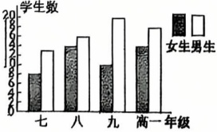

如图 12-X-1, 根据条形图所提供的信息, 下列说法正确的是 ( )

图 12-X-1 

A. 八年级学生最少

B. 九年级的男生人数是女生人数的两倍

C. 高一年级女生比男生多

D. 八年级和高一年级的学生数一样多

> [!question]- 点击查看答案与解析
> **【答案】** B
>
> **【考点】** 条形图的阅读与数据分析 [[【初中数学知识点体系-人教版】#12-2 用统计图描述数据]]
>
> **【解析】**
> 本题考察从条形图中读取数据并进行比较分析的能力。
> - 选项A："八年级学生最少"——需比较各年级的合计人数（男生+女生），找出最小值；
> - 选项B："九年级的男生人数是女生人数的两倍"——需查看九年级男生与女生的具体数据，验证是否满足 $男生=2\times女生$；
> - 选项C："高一年级女生比男生多"——需比较高一年级的男生与女生人数；
> - 选项D："八年级和高一年级的学生数一样多"——需比较八年级与高一年级的合计人数。
> 解题时应逐一读取条形图中对应条柱的高度（数值），逐项验证每个选项的正误。
>
> **【易错点】** 读取条形图时容易看错条柱高度对应的刻度值，或混淆不同年级、不同性别的数据。
