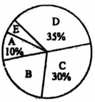
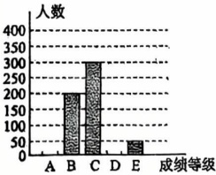

某学校组织了手抄报作品征集活动，先从中随机抽取部分学生的作品，按照 A, B, C, D, E 五个等级进行评价，然后根据统计结果绘制了如图 12-X-2 所示的两幅不完整的统计图 (A: 59 分及以下；B: 60~69 分；C: 70~79 分；D: 80~89 分；E: 90~100 分). 下列选项错误的是 ( )

图 12-X-2 

A. 共抽取了 1000 名学生的作品  

B. 59 分及以下的人数是 100  

C. 在扇形图中，B 等级所对应的扇形圆心角的度数是 $62^{\circ}$  

D. E 等级的学生人数所占的百分比为 5%

> [!question]- 点击查看答案与解析
> **【答案】** C
>
> **【考点】** 扇形图与条形图的综合分析 [[【初中数学知识点体系-人教版】#12-2 用统计图描述数据]]
>
> **【解析】**
> 本题考察从两幅统计图中提取信息并综合计算的能力。解题思路如下：
> 对于选项A："共抽取了1000名学生的作品"——观察条形图中各等级的人数之和，验证总人数是否为1000；
> 对于选项B："59分及以下的人数是100"——在条形图中找到A等级（59分及以下）对应的人数，验证是否为100；
> 对于选项C："B等级所对应的扇形圆心角的度数是 $62^{\circ}$"——先求出B等级人数占总人数的百分比，再乘以 $360^{\circ}$，即 $圆心角 = \frac{B等级人数}{总人数} \times 360^{\circ}$，验证结果是否为 $62^{\circ}$；
> 对于选项D："E等级的学生人数所占的百分比为5%"——E等级人数除以总人数 $\times 100\%$，验证是否为5%。
> 计算时注意：扇形圆心角 $= \frac{部分}{总体} \times 360^{\circ}$，百分比 $= \frac{部分}{总体} \times 100\%$。
>
> **【易错点】** 扇形圆心角计算时忘记乘以 $360^{\circ}$；百分比计算时忘记乘以 $100\%$；条形图与扇形图中同一等级的人数对应关系容易出错。
