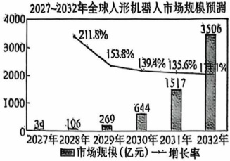

随着人工智能技术的不断突破，人形机器人行业备受关注，未来行业将持续保持高速发展，如图 12-X-3 是某机构对 2027～2032 年全球人形机器人市场规模预测的数据：

图 12-X-3 

根据预测数据，下列分析正确的是（ ）

$①$ 2027～2032 年全球人形机器人市场规模逐年增长；

$②$ 2027～2032 年全球人形机器人市场规模增长率逐年增大；

$③$ 2027～2032 年全球人形机器人市场规模超 6000 亿元；

$④$ 若保持与 2032 年相同的年增长率，到 2034 年全球人形机器人市场规模将超 1.5 万亿元.

A. $②③$

B. $②③④$

C. $①③④$

D. 只有 $②$

> [!question]- 点击查看答案与解析
> **【答案】** C
>
> **【考点】** 折线图的阅读与数据分析 [[【初中数学知识点体系-人教版】#12-2 用统计图描述数据]]
>
> **【解析】**
> 本题考察从折线统计图中获取信息并进行推理判断的能力。
> 分析各结论：
> $①$ "2027～2032年全球人形机器人市场规模逐年增长"——观察折线图，若每年的数据点均高于前一年，则逐年增长成立；
> $②$ "2027～2032年全球人形机器人市场规模增长率逐年增大"——增长率 $= \frac{当年值-上年值}{上年值} \times 100\%$，需逐年计算增长率，看是否每年递增，通常市场规模不会每年保持增长率递增；
> $③$ "2027～2032年全球人形机器人市场规模超6000亿元"——看2032年的预测值是否超过6000亿元；
> $④$ "若保持与2032年相同的年增长率，到2034年全球人形机器人市场规模将超1.5万亿元"——先计算2032年的年增长率，再按此增长率推算2033年和2034年的值：$2034年值 = 2032年值 \times (1+增长率)^2$，验证是否超过1.5万亿元。
> 解题时应逐一读取折线图中各年份对应的数据值，进行精确计算后判断。
>
> **【易错点】** 混淆"增长量"与"增长率"的概念；增长率逐年增大的判断需要进行多步计算而非直观判断。
