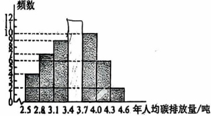

（2025 东部区期末）某校七年级（1）班数学小组在“低碳生活”实践活动中，了解到每个人的日常消费都会产生二氧化碳排放。为了解同学们家庭的碳排放情况，该小组随机抽取了该校部分七年级学生家庭，收集了这些家庭 2024 年的人均碳排放量的数据，并对数据进行整理、描述和分析。下面给出了部分信息。

a. 抽取的七年级学生家庭 2024 年的人均碳排放量数据的频数分布表如下：

| 年人均碳排放量x/吨 | 频数  | 百分比 |
| ---------- | --- | --- |
| 2.5≤x＜2.8  | 4   | 8%  |
| 2.8≤x＜3.1  | 7   | n   |
| 3.1≤x＜3.4  | 9   | 18% |
| 3.4≤x＜3.7  | m   | 24% |
| 3.7≤x＜4.0  | 10  | 20% |
| 4.0≤x＜4.3  | 6   | 12% |
| 4.3≤x＜4.6  | 2   | 4%  |

b. 抽取的七年级学生家庭 2024 年的人均碳排放量数据在 $2.8 \leqslant x < 3.1$ 这一组的是；

2.8, 2.8, 2.9, 2.9, 3.0, 3.0, 3.0.

c. 抽取的七年级学生家庭 2024 年的人均碳排放量数据的频数分布直方图如下：

图 12-X-4 

根据以上信息，回答下列问题：

(1) 这里采用的调查方式是 ___ （填“全面调查”或“抽样调查”）；

(2) 填空: $m=\_\_\_, n=\_\_\_$，并把频数分布直方图补充完整；

(3) 估计该校七年级 700 个学生家庭中，2024 年的人均碳排放量不超过 3 吨的家庭有多少户.

> [!question]- 点击查看答案与解析
> **【答案】** (1) 抽样调查；(2) $m=12$，$n=14\%$；(3) 154户
>
> **【考点】** 用样本估计总体 [[【初中数学知识点体系-人教版】#12-1 统计调查]]
>
> **【解析】**
> (1) 该数学小组"随机抽取了该校部分七年级学生家庭"，是从总体中抽取部分个体进行调查，故调查方式为抽样调查。
>
> (2) 由已知条件，$2.5 \leqslant x < 2.8$ 组的频数为4，占 $8\%$，
> 则抽取的总家庭数为：$4 \div 8\% = 50$（户）。
> $3.4 \leqslant x < 3.7$ 组的百分比为 $24\%$，故 $m = 50 \times 24\% = 12$。
> $2.8 \leqslant x < 3.1$ 组的频数为7，故 $n = \frac{7}{50} \times 100\% = 14\%$。
> 补全频数分布直方图：将 $3.4 \leqslant x < 3.7$ 组的条柱高度画至12。
>
> (3) 人均碳排放量"不超过3吨"即 $x \leqslant 3.0$。
> 包含两组数据：$2.5 \leqslant x < 2.8$ 组（4户）和 $2.8 \leqslant x < 3.1$ 组中不超过3.0的部分。
> $2.8 \leqslant x < 3.1$ 组的具体数据为：2.8, 2.8, 2.9, 2.9, 3.0, 3.0, 3.0，全部不超过3.0吨（$3.0 \leqslant 3.0$），共7户。
> 故 $50$ 户中不超过3吨的家庭数为：$4 + 7 = 11$（户），占比 $\frac{11}{50} = 22\%$。
> 估计全校七年级700户家庭中：$700 \times 22\% = 154$（户）。
> 答：估计该校七年级700个学生家庭中，2024年人均碳排放量不超过3吨的家庭约有154户。
>
> **【易错点】** 第(3)问中容易忽略 $2.8 \leqslant x < 3.1$ 组中只有部分数据不超过3.0，直接将该组全部7户计入导致多算；或将3.0本身排除（$3.0 = 3.0$，应计入"不超过"的范围）。
