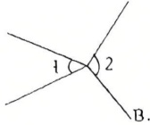
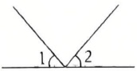
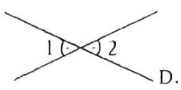
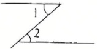

下面四个图形中，$\angle 1$ 与 $\angle 2$ 互为对顶角的是 ( )

A.

B.

C.

D.

> [!question]- 点击查看答案与解析
> 【答案】C
> 
> 【考点】对顶角的定义 → [[【初中数学知识点体系-人教版】#7-1 相交线]]
> 
> 【解析】
> 对顶角：两条直线相交，有公共顶点，且两边互为反向延长线的两个角互为对顶角。
> - 选项A：$\angle 1$ 与 $\angle 2$ 没有公共顶点，不是对顶角；
> - 选项B：$\angle 1$ 与 $\angle 2$ 虽然有公共顶点，但两边不互为反向延长线，不是对顶角；
> - 选项C：两条直线相交，$\angle 1$ 与 $\angle 2$ 有公共顶点且两边互为反向延长线，是对顶角，正确；
> - 选项D：$\angle 1$ 与 $\angle 2$ 虽然有公共顶点，但不是两条直线相交形成的对顶角关系，错误。
> 
> 【易错点】对顶角必须是两条直线相交形成的，且两边互为反向延长线。
