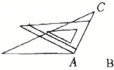
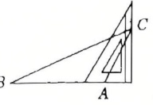
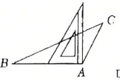
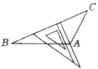

下列选项中，过点 $A$ 画 $BC$ 的垂线 $AD$，三角板摆放正确的是 ( )

A.

B.

C.

D.

> [!question]- 点击查看答案与解析
> 【答案】C
> 
> 【考点】垂线的画法 → [[【初中数学知识点体系-人教版】#7-1 相交线]]
> 
> 【解析】
> 过点 $A$ 画 $BC$ 的垂线 $AD$，三角板的正确摆法是：一条直角边与 $BC$ 重合，另一条直角边经过点 $A$。
> - 选项A：三角板的直角边没有与 $BC$ 重合，错误；
> - 选项B：三角板的一条直角边与 $BC$ 重合，但没有经过点 $A$，错误；
> - 选项C：三角板的一条直角边与 $BC$ 重合，另一条直角边经过点 $A$，正确；
> - 选项D：三角板没有利用直角边来画垂线，错误。
> 
> 【易错点】画垂线时，三角板的一条直角边必须与已知直线重合。
