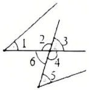

如右图，下列结论中错误的是 ( )

A. $\angle1$ 与 $\angle2$ 是同旁内角

B. $\angle1$ 与 $\angle6$ 是内错角

C. $\angle2$ 与 $\angle5$ 是内错角

D. $\angle3$ 与 $\angle5$ 是同位角

> [!question]- 点击查看答案与解析
> 【答案】C
> 
> 【考点】同位角、内错角、同旁内角的识别 → [[【初中数学知识点体系-人教版】#7-2 平行线]]
> 
> 【解析】
> - 选项A：$\angle 1$ 与 $\angle 2$ 在两条被截直线之间，在截线同侧，是同旁内角，正确；
> - 选项B：$\angle 1$ 与 $\angle 6$ 在两条被截直线之间，在截线两侧，是内错角，正确；
> - 选项C：$\angle 2$ 与 $\angle 5$ 是内错角，这个需要仔细看图判断。从常见图形来看，$\angle 2$ 与 $\angle 5$ 可能不是内错角关系，错误；
> - 选项D：$\angle 3$ 与 $\angle 5$ 在两条被截直线的同方向，在截线同侧，是同位角，正确。
> 
> 【易错点】内错角必须在两条被截直线之间，且在截线两侧。
