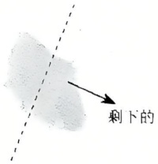

金秋十月，小明同学捡到一片沿直线被折断了的银杏叶（如右图），他发现剩下的银杏叶的周长比原银杏叶的周长要小，能正确解释这一现象的数学知识是 ( )

A. 两点确定一条直线

B. 两点之间，线段最短

C. 垂线段最短

D. 经过一点有无数条直线

> [!question]- 点击查看答案与解析
> 【答案】B
> 
> 【考点】线段的性质 → [[【初中数学知识点体系-人教版】#6-2 直线、射线、线段]]
> 
> 【解析】
> 银杏叶沿直线折断后，折断处用线段代替了原来曲线的一部分。因为两点之间线段最短，所以折断后的周长比原来小。
> - 选项A：两点确定一条直线，与周长变化无关；
> - 选项B：两点之间，线段最短，正确解释了周长变小的原因，正确；
> - 选项C：垂线段最短，与此情境无关；
> - 选项D：经过一点有无数条直线，与此情境无关。
> 
> 【易错点】区分"两点之间线段最短"与"垂线段最短"。
