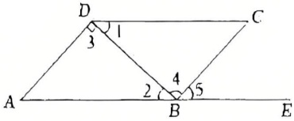

如图，点 $E$ 在 $AB$ 的延长线上，下列条件中可以判断 $AB∥DC$ 的是 ( )

A. $\angle A = \angle 5$

B. $\angle 3 = \angle 4$

C. $\angle ABC + \angle C = 180^\circ$

D. $\angle ADC = \angle ABC$

> [!question]- 点击查看答案与解析
> 【答案】C
> 
> 【考点】平行线的判定 → [[【初中数学知识点体系-人教版】#7-2 平行线]]
> 
> 【解析】
> - 选项A：$\angle A=\angle 5$ 是同位角关系，可以判断 $AD\parallel BC$，而非 $AB\parallel DC$，错误；
> - 选项B：$\angle 3=\angle 4$ 是内错角关系，可以判断 $AD\parallel BC$，而非 $AB\parallel DC$，错误；
> - 选项C：$\angle ABC+\angle C=180^{\circ}$，同旁内角互补，可以判断 $AB\parallel DC$，正确；
> - 选项D：$\angle ADC=\angle ABC$ 是平行四边形的性质，但不能直接判断 $AB\parallel DC$，错误。
> 
> 【易错点】判定哪两条直线平行，要看角是哪两条直线被哪条直线所截形成的。
